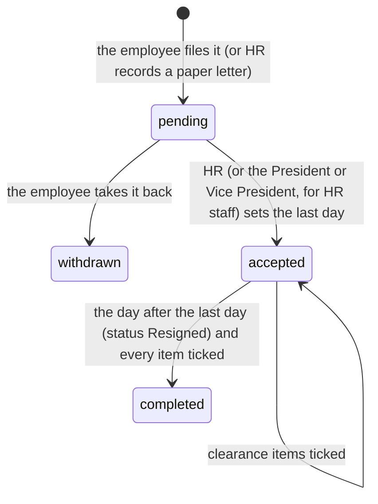

# 26. Resignation and clearance

The other end of onboarding. Before this, leaving was only a status HR set on the employee form; now it has the letter, the notice, the last day, a clearance checklist and final pay.

## The rules it follows

- **Labor Code Art. 300(a):** written notice at least **30 days** before the last day. **300(b):** none for a just cause (serious insult, inhuman treatment, a crime against the employee or their family, and the like).
- **DOLE Labor Advisory 06-20:** final pay within **30 days** of separation; the Certificate of Employment within **3 days** of the request.
- There is no "reject": resigning is the employee's right. HR only settles the date.

## The flow

1. **Filing** (My Profile → "File your resignation" → `/resignation`, `MyResignation`): the reasons as a **checklist** (tick all that apply, nothing pre-ticked): personal reasons (another job, pay, work environment, schedule, health, family, moving, school, "Others" with words), shown as tiles. **Art. 300(b)'s just causes** stay folded behind one question ("The company, or someone acting for it, did something to me that makes me leave at once"; unticking it clears them). Then come the four items, each labelled with its paragraph: serious insult, inhuman treatment, a crime against them or their family, or an analogous cause. Ticking a just cause removes the 30-day rule. Under the checklist, **"Read the law: Labor Code Art. 300"** opens the article's text. The form is in four numbered steps (reasons, last day, letter, **Before you send**). The last step lists what happens next in plain sentences (`Resignation::acknowledgementLines()`): free will, or for a just cause "what I say is true"; the 30 days' notice and damages under Art. 300(a); withdrawal until accepted; returning property; the written authorization to deduct what's owed (Art. 113); final pay within 30 days and a COE within 3 days (DOLE Labor Advisory No. 06, s. 2020); and the account closing. "I've read these, and I understand them" is required. The lines are saved word for word with the time (`acknowledgement`, `acknowledged_at`), and HR sees them in the detail. A paper letter entered by HR has none. Then the letter, the last day asked (30 days ahead by default). Under 30 days without a just cause, the employee must tick "ask HR to waive the rest", or it's refused with the earliest allowed date. One at a time (`FileResignation`).
   - **"Use a sample letter"** (`Resignation::sampleLetter()`) fills the letter from the reasons, their position and the last day. Replacing what they wrote asks first. For a just cause it leaves *"What happened: [when, where, who…]"*, and the form won't send until the [brackets] are replaced.
   - **A just cause opens a complaint case** about what happened ([21](21-complaints.md)), for the same handler and linked both ways (`complaints.resignation_id`). The resignation shows the case and its status, so the accusation is looked into and closed with a written outcome, not only answered with a last day.
2. **Withdrawing** while pending (`WithdrawResignation`). Once accepted, changing it is a conversation with HR.
3. **Accepting** (`/resignations`, `Resignations`, `AcceptResignation`): the last day as asked or another agreed one, and an optional note. A last day under 30 days' notice without a just cause is recorded as **notice waived**. The employee is told (bell + email, with the final-pay date); for a guard, Operation HQ and the region's Satellite are told too, to cover the post.
4. **Clearance** (`UpdateClearance`): each item ticked with who and when. Firearm and post equipment for guards only (`ClearanceItem::for()`). "Loans and load settled" shows what's still owed (active deductions' remaining balance); "Final pay released" shows its due date.
5. **Separation** (`app:apply-separations`, daily 00:10, `ApplySeparations`): the day after the last day the status becomes **Resigned**, which closes the account as before (sign-in refused, sessions ended). Once each.
6. **Completion** (`CompleteResignation`): when separated **and** every item is ticked, whichever happens last. The employee is told by email.
7. **Final pay** ([27](27-final-pay-and-cash-bond.md)): Accounting prepares and signs it from the last day; the President or Vice President's signature releases it and ticks "Final pay released". What they still owe is **always deducted** for a resignation filed in the system: the "Before you send" acknowledgement includes the written authorization (Art. 113), so filing sets `deduction_consent_at`. Only a paper letter HR enters without a signed authorization leaves the debt shown but not deducted.

## Why people leave

HR's Resignations page ends with **Why people leave** (`ResignationReasonsQuery`). It counts each reason ticked on the resignations that person handles, filed in the last 12 months (withdrawn ones not counted), most common first. Each reason has a bar and its split between guards and office staff, and the "Others" are listed in their own words. One resignation can tick several reasons, so the counts add up to more than the resignations.

## Who handles it

| | Who | Gate |
|---|---|---|
| Everyone's but HR staff's | HR, Super Admin | `handle-resignations` |
| An HR member's own | the President or Vice President, Super Admin | `handle-hr-resignations` (`resignations.for_executive`, set when filed) |

**Not the President or Vice President** (company decision, 2026-10-15): their leaving is handled outside the system. The profile link and `/resignation` are hidden from them (paid outside payroll), HR's "record a paper letter" doesn't list them, and `FileResignation` refuses them.

As with complaints, other HR staff can't see or open an HR member's resignation. HR can **record a paper letter** for someone they handle (`recorded_by`).

## Where it shows

- Employee: a quiet link at the end of **My Profile**; **My Resignation** in the menu only while one is in progress.
- HR / the President or Vice President: **Management → Resignations**, badge = pending; on the dashboard, "Waiting for you · Resignations · to accept".

Tests: `tests/Feature/People/ResignationTest.php` (notice rule and waiver, just cause, one at a time, withdraw, accept with waiver and who's told, HR staff → President or VP, clearance and the owed balance, separation the day after, completion, paper letter, page access).

## Not yet

- Termination (dismissal for just or authorized causes) needs due process (two notices, a hearing) and is a separate flow; HR still sets "Terminated" on the employee form.
- The Certificate of Employment as a generated document.
