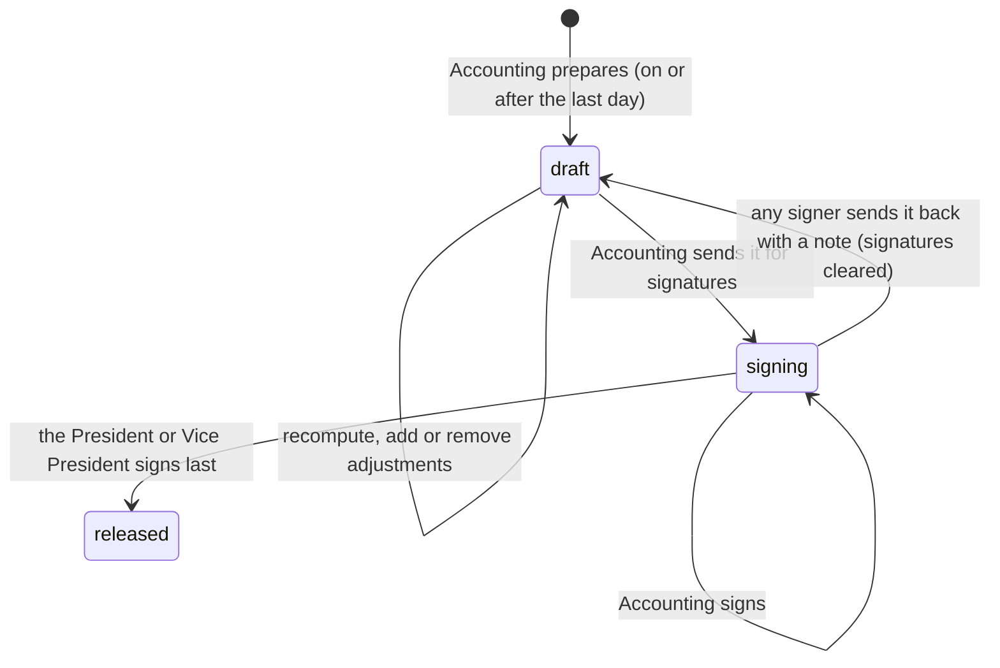

# 27. Final pay and the cash bond

What someone who resigned gets at the end. It continues [26](26-resignation.md): once the last day has passed, Accounting prepares and signs a statement, and the President or Vice President's signature releases it. Only these two see the amounts.

## The company's decisions (2026-10-15)

1. **Leave is not converted to cash.** Unused leave is taken as leave (approved or rescheduled), never paid out. *Caveat:* Labor Code **Art. 95** makes unused Service Incentive Leave (5 days a year) convertible to cash, unless the company already gives at least 5 days of paid leave a year. Keep the leave policy at 5+ paid days so this holds.
2. **Cash bond: ₱200 a month, ₱100 per cut-off,** from every guard's payslip. It's refunded in full in final pay (Art. 114: deposits are allowed where the trade recognises them, as security agencies do).
3. **Accounting signs, then the President or Vice President, last.** The President or Vice President's signature releases it. *Changed 2026-10-16:* at first five signed (Operation HQ, Admin, HR, Accounting, the President or Vice President), but that showed everyone's pay to HR, Operation HQ and Admin. Now **only Accounting and the President or Vice President see final pay amounts**. HR, Operation HQ and Admin confirm their part on the resignation's **clearance** (ID and uniform, firearm and equipment, turnover) instead of signing the pay.
4. **What's owed is deducted from the final pay** (Art. 113 asks for the employee's written authorization). A resignation filed in the system always has it: the required "Before you send" acknowledgement includes *"I authorize the company to deduct what I still owe… from my final pay and cash bond"*. For a paper letter, HR ticks it only with their signed authorization; without one, the debt is shown but not deducted. The cash bond is used first, the final pay never goes below zero, and anything left over stays as a **receivable**, collected separately.

## The statement (`FinalPayStatementQuery`)

| Line | Kind | Where it comes from |
|---|---|---|
| Salary up to the last day | info, **not counted** | The last payslip. The person is on payroll until their last day, so the regular run pays it. If days worked have no payslip yet, a warning says to generate the last cut-off in Payroll. |
| 13th month (pro-rated) | + | `ThirteenthMonthBasisQuery` up to the last day: earned − already paid ([16](16-thirteenth-month.md)) |
| Cash bond refund | + | `CashBondBalanceQuery`: paid in before the system + collected from payslips ± corrections |
| Adjustments | + or − | Added by Accounting, each with a label, an amount and a reason (e.g. unused uniform allowance, a damaged radio) |
| Loans, cash advances, load still owed | − | Active deductions with a remaining balance. **With consent:** deducted. **Without:** shown as info, not deducted, with a warning. |

**Net** = added − taken off, never below 0. **Receivable** = whatever is still owed beyond that.

Example (the test): 13th month ₱254.17 + bond ₱100 = ₱354.17; a ₱300 loan with consent leaves **₱54.17**. A ₱1,000 loan gives ₱0.00 and a **₱645.83 receivable**.

## The flow

1. **Prepare** (`/final-pay`, `PrepareFinalPay`): Accounting, once the resignation is accepted and the last day has come. Recomputing reads everything again; adjustments are kept.
2. **Send for signatures** (`SubmitFinalPay`): the statement is frozen. Accounting is told (bell + email).
3. **Sign** (`SignFinalPay`): Accounting signs; the President or Vice President is then told. Nobody signs their own final pay.
4. **Send back** (`ReturnFinalPay`): Accounting or the President or Vice President, with a note; it returns to draft and the signatures are cleared. Accounting is told.
5. **Release** (the President or Vice President's signature):
   - the cash bond is refunded (a negative ledger entry) and its ₱100 deduction stops;
   - the loans on the statement are settled as far as the final pay covered them (matched by `deduction_id`); the rest stays on the loan as the receivable;
   - "Final pay released" is ticked on the clearance, which may complete the resignation;
   - the employee is emailed the net amount, and Accounting is told;
   - December's 13th-month run counts the amount already paid, so it isn't paid twice.

The due date is **30 days after the last day** (DOLE Labor Advisory 06-20). The list shows it, with an amber dot when it's overdue.

## Cash bonds (`/cash-bonds`, Accounting)

- **New guards** are enrolled when they create their account (`ClaimEmployeeAccount` → `EnrollCashBond`): a `cash_bond` deduction of ₱100 a cut-off. Office staff aren't enrolled.
- **Existing guards:** use **Enroll all guards** once (or `php artisan app:enroll-cash-bonds`). It's safe to run again; nobody is enrolled twice.
- **Paid in before the system:** **Enter** once per person (the opening balance, never negative).
- **Correct:** a + or − correction, which needs a reason.
- The balance is opening + collected from payslips (`loan_lines` of type `cash_bond`) ± corrections − refunded. It's a deduction, so it doesn't reduce taxable pay.

## Who

| | Who | Gate |
|---|---|---|
| Prepare, adjust, send, Cash Bonds | Accounting, Super Admin | `prepare-final-pay` |
| Open Final Pay and sign | Accounting, President, Vice President, Super Admin (looks, doesn't sign) | `sign-final-pay` |

The menu badge counts the ones waiting for **your** signature, plus, for Accounting, resignations past their last day with no statement yet or one still in draft. On the dashboard: "Waiting for you · Final pay · to prepare or sign".

## Data

- `cash_bond_entries`: `kind` (opening / adjustment / refund), signed `amount`, `note`, `recorded_by`, `final_pay_id`.
- `final_pays`: one per resignation. Stores the `lines` and `adjustments` (JSON), the totals, `net`, `receivable`, `thirteenth_amount`, `cash_bond_refund`, the `signoffs` (role → who and when), and who prepared, submitted, returned or released it.
- `resignations.deduction_consent_at`.
- Migration `2026_10_15_100002_create_final_pay_and_cash_bonds`.

**Sample data** (`php artisan db:seed --class=FinalPaySampleSeeder`, after `PayrollSampleSeeder`; it skips anyone who already has a resignation). There's one case for each stage, each with a cash bond paid in before the system:

| Guard | Last day | Stage |
|---|---|---|
| Liza Pascual (guard2) | today | Ready for Accounting to prepare; the last cut-off has no payslip yet, so the warning shows |
| Marlon Mendoza (guard8) | Sep 30 | Draft with a −₱350 adjustment; the loan is deducted with consent, net ₱89 |
| Ferdinand Ramos (guard4) | Sep 30 | Sent for signatures, Accounting signs next; no consent, so the Pag-IBIG loan is shown but not deducted |
| Antonio De Guzman (guard3) | Sep 30 | Released; a ₱6,000 cash advance is more than the pay, so net ₱0 and a ₱3,106.08 receivable |

Tests: `tests/Feature/Payroll/FinalPayTest.php` covers the bond ledger and its rules, the statement, no consent → not deducted, never below zero, Accounting then the President or Vice President signing (and HR, Operation HQ and Admin refused) and the release, sending back, waiting for the last day, enrolment at registration, and page access.

## Not yet

- A printable final-pay slip / quitclaim for the employee to sign on receipt.
- Recording the receivable's later collection (today it stays as the loan's remaining balance).
- Final pay for termination (see [26](26-resignation.md), "Not yet").
