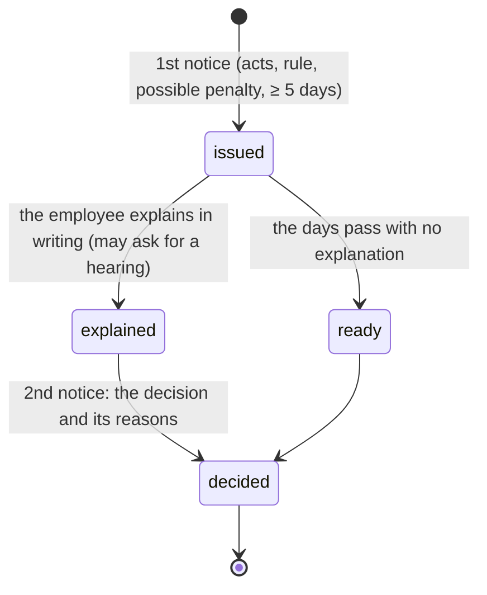

<!-- markdownlint-disable MD013 -->
# 29. Notices to Explain

Procedural due process before a real sanction (roadmap item 30): the **twin-notice rule** (Labor Code Art. 297–299; *King of Kings Transport v. Mamac*, 2007). A demerit ([28](28-merits-and-demerits.md)) is for minor things; anything that could lead to a suspension or dismissal goes through here.

## The steps

1. **The Notice to Explain** (`IssueNoticeToExplain`): all four are required, because due process needs all four.
   - **The specific acts**: what, when, where, who saw it. A vague charge isn't enough.
   - **The rule or policy** it breaks.
   - **The penalty it could lead to**: a written reprimand, a suspension, or dismissal.
   - **At least 5 calendar days** to explain in writing (`NoticeToExplain::MIN_DAYS`). The form refuses anything shorter.

   The employee is told by bell and email.
2. **Received** (`AcknowledgeNotice`): on **My Notices** the employee taps *I received this notice*. That isn't agreeing; it's the proof the notice was served. Writing an explanation also counts.
3. **The explanation** (`ExplainNotice`): once, within the days given, with an option to ask for a hearing. Whoever issued it is told.
4. **A hearing** (`ScheduleNoticeHearing`), optional: when asked for, or when the facts need it. When and where; the employee is told.
5. **The decision** (`DecideNotice`), the second notice: **only once due process is done**, meaning the explanation is in or the days have passed. Before that the form isn't shown, and the Action refuses. Its options are **cleared**, a **written reprimand**, a **suspension** (1–30 days, from a date), or **dismissal**, always with the reasons. It can also give a **demerit** from HR's list. The employee is told, and taps *I received the decision*.
   - **Dismissal:** HR is told, to set "Terminated" on the employee record and start the clearance and final pay. Nothing is changed automatically.
   - **Suspension:** simply no attendance to pay for those days.

## Who

| The employee | Who issues, hears and decides (`NoticeToExplain::canIssue`) | Who also reads them |
|---|---|---|
| A guard | Operation HQ, or their region's Satellite Operation | HR, the President or Vice President |
| A Satellite Operation | Operation HQ (their head, `App\Support\Heads`) | HR, the President or Vice President |
| Other office staff | HR | the President or Vice President |
| HR staff | the President or Vice President | (other HR staff don't) |
| Anyone | Super Admin. Never yourself. | |

The roadmap first said "Operations + Super Admin only". That still holds for guards. Office staff and HR staff need someone too, so it follows the same rule as merits.

Picking the employee works like merits ([28](28-merits-and-demerits.md)): by name or employee number, with suggestions from the site of your last notice before you type.

## Where it shows

- **Notices to Explain** (menu, `issue-notices-to-explain`): the list, with where each stands ("Waiting for the explanation (until Oct 21)", "Explained · to decide", "No explanation · to decide"). The badge counts the ones you issued that are ready to decide; on the dashboard, "Waiting for you · to decide".
- **My Notices** (personal menu, only for someone who has one): each notice in full, with the buttons. The badge counts what still needs them.
- **The 201 file**: the person's notices and where each stands, with **Issue one** for whoever may.

Every step is audited (`nte.issued`, `nte.received`, `nte.explained`, `nte.hearing_set`, `nte.decided`, `nte.decision_received`).

Data: `notices_to_explain` (migration `2026_10_16_100004`). Tests: `tests/Feature/People/NoticesToExplainTest.php`.

**Have HR or counsel review the wording of your notices** (the rules cited, the penalties) before the first real one: the system enforces the steps, not the legal merits of a charge.
